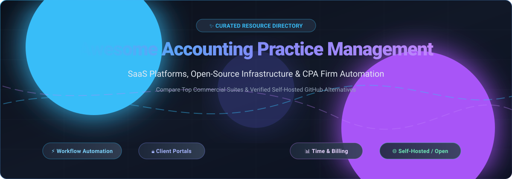

# 💼 Awesome Accounting Practice Management

**Curated directory of SaaS suites, workflow automation systems, client portals, and self-hosted open-source software for CPAs, bookkeepers, and modern accounting firms.**

🌟 *Star this repository to follow new software releases and industry updates!* 🌟

---

## 📑 Table of Contents

- [🌐 Sector Overview & Market Dynamics](#-sector-overview--market-dynamics)
- [🏢 SaaS & Hosted Commercial Platforms](#-saas--hosted-commercial-platforms)
- [💻 Open-Source GitHub Projects](#-open-source-github-projects)
- [🛠️ Comparative Tech Stacks & Architecture](#-comparative-tech-stacks--architecture)
- [🤝 How to Contribute](#-how-to-contribute)
- [💖 Support](#-support)
- [📈 Star History](#-star-history)
- [⚠️ Disclaimer](#-disclaimer)

---

## 🌐 Sector Overview & Market Dynamics

The global **Accounting Practice Management Software (APMS)** market is estimated at approximately **$1.3B to $1.8B** (projected to reach over $3.5B by the early 2030s at an ~8–10% CAGR), forming a high-value niche within the broader $15B+ accounting software sector. The market is **moderately fragmented overall**, characterized by large enterprise incumbents and roll-up acquirers (such as IRIS Software, Xero, Intuit, and Zoho) consolidating top-tier market share, while a competitive long tail of specialized, regional, and cloud-native point solutions compete for independent CPA and bookkeeping firms.

---

## 🏢 SaaS & Hosted Commercial Platforms

| 🏢 Company | 💰 Estimated Revenue / Valuation | 🏷️ Starting Pricing | 🎁 Free Tier / Free Trial Limits | 📋 Description & Key Focus |
| :--- | :--- | :--- | :--- | :--- |
| **Zoho Practice** (Zoho Corp) | ~$1.5B Revenue / ~$12.5B Valuation | $49/month (Standard plan) | Free forever for registered Zoho Finance Partners (core practice management, task automation, and document management); 14-day free trial for non-partners with full feature access | Practice management deeply integrated into the Zoho ecosystem (Zoho Books). Best for Zoho-centric firms. |
| **Senta** (IRIS Software Group) | ~$300M+ Parent Revenue (~$4M ARR at acquisition) / ~$4B Parent Valuation | £32/user/month (or £25.60/user/month billed annually) | 30-day free trial; full feature access with no credit card required upfront; trial data carries over | Practice management and CRM tailored for UK/global accounting and bookkeeping practices with powerful automated workflows. |
| **Ignition** (Practice Ignition) | ~$30M ARR / ~$330M Valuation ($90M+ raised) | $39/month (Solo plan, annual billing for firms under $150K revenue) | 14-day free trial; full feature access (proposals, engagement letters, payment collection) with no credit card required | Client engagement, proposal-to-payment automation, and recurring billing for professional services. |
| **Canopy** | ~$35M–$40M ARR / ~$245M+ Total Funding | $74/seat/month (Standard tier, billed annually) | 14-day sales-assisted trial; full access to core modules (CRM, portal, document management) with no credit card required | All-in-one practice management, tax resolution, document management, and client portal for accounting firms. |
| **Karbon** | ~$25M–$35M ARR / ~$99M+ Total Funding | $59/user/month (Team plan, billed annually) or $79/user/month billed monthly | 14-day free trial; access to triage email, task templates, and collaboration tools via guided demo/sign-up | Collaborative practice management with deep email triage integration and standardized team workflows. |
| **TaxDome** | ~$20M–$30M ARR (Bootstrapped, 10,000+ firms) | $1,500/year (covers first 150 active client accounts and up to 20 firm team members) | No permanent free tier or standard trial for core platform; offers a 14-day free trial specifically for optional AI & API add-on; live personalized demo available | All-in-one platform covering CRM, client portal, automated pipelines, e-signatures, and firm billing. |
| **Financial Cents** | ~$3M–$5M ARR / Privately Held | $19/month (Solo plan, billed annually at $228/year) | 14-day free trial with full platform access; features an indefinite free tier strictly for the Month-End Close tool (limited to 1 client forever) | Practice management and workflow tracking with integrated client invoicing and automated client requests. |
| **Jetpack Workflow** | ~$850K ARR / ~$2.1M Total Seed Funding | $40/user/month (Starter plan, billed annually at $480/user/year) or $49/user/month billed monthly | 14-day free trial; full feature access to workflow templates and recurring jobs with no credit card required upfront | Recurring job, deadline, and task management built specifically for accounting and bookkeeping firms. |
| **Client Hub** | ~$950K–$1M ARR / TinySeed & CPA.com Backed | $49/user/month (Solopreneur plan, billed annually) or $59/user/month (Practice Manager, annual) | 14-day free trial; unrestricted access to client portal, automated client tasks, and magic workflow tools without credit card | Client communication hub, portal, and workflow automation focused on eliminating client communication bottlenecks. |
| **Aero Workflow** | ~$300K–$500K ARR / Bootstrapped | $108/month flat fee (Startup plan, billed annually, up to 5 users included with no per-seat fees) | 30-day free trial; full feature access including unlimited tasks, pre-built templates, and QuickBooks sync without credit card | Flat-rate workflow and procedural knowledge-base software eliminating per-seat pricing for bookkeeping teams. |

---

## 💻 Open-Source GitHub Projects

Explore verified open-source repositories suitable for self-hosted firm management, billing pipelines, CRM workflows, and bookkeeping infrastructure. Repositories are sorted descending by GitHub stargazers.

- ### 1. [Twenty](https://github.com/twentyhq/twenty) 
  - 🛠️ **Tech Stack**: TypeScript, NestJS, React, GraphQL, PostgreSQL
  - 📜 **License**: AGPL-3.0
  - 💡 **Best For**: Modern open-source CRM, client pipeline management, custom firm data models, and client relation tracking.
  - 🔍 **Overview**: Modern, extensible alternative to proprietary CRMs. Highly customizable data models make it ideal for modeling accounting client accounts, engagements, onboarding pipelines, and team assignments.

- ### 2. [Odoo Community](https://github.com/odoo/odoo) 
  - 🛠️ **Tech Stack**: Python, JavaScript, PostgreSQL
  - 📜 **License**: LGPL-3.0
  - 💡 **Best For**: Enterprise practice management, multi-entity client billing, integrated timesheets, and accounting suites.
  - 🔍 **Overview**: Broad open-source ERP with extensive modularity. Combining Odoo's Project, Timesheet, Invoicing, and CRM modules creates a comprehensive, self-hosted accounting practice management system.

- ### 3. [ERPNext](https://github.com/frappe/erpnext) 
  - 🛠️ **Tech Stack**: Python, Frappe Framework, MariaDB, Redis
  - 📜 **License**: GPL-3.0
  - 💡 **Best For**: Full-suite practice operations, automated recurring billing, project milestones, and double-entry general ledger.
  - 🔍 **Overview**: The leading complete open-source ERP system on GitHub. Includes comprehensive project task boards, billable timesheets, client portal access, double-entry financial accounting, and payroll out of the box.

- ### 4. [Documenso](https://github.com/documenso/documenso) 
  - 🛠️ **Tech Stack**: TypeScript, Next.js, Prisma, PostgreSQL
  - 📜 **License**: AGPL-3.0
  - 💡 **Best For**: Self-hosted engagement letters, proposal signing, 8879 / tax authorization signatures, and document execution.
  - 🔍 **Overview**: The open-source document signing infrastructure. Allows CPA firms to self-host legally binding electronic signature workflows and seamlessly integrate signature requests into client portals via API.

- ### 5. [Invoice Ninja](https://github.com/invoiceninja/invoiceninja) 
  - 🛠️ **Tech Stack**: PHP (Laravel), Flutter, Vue.js, MySQL
  - 📜 **License**: Elastic License 2.0 (Self-Hostable)
  - 💡 **Best For**: Client billing, payment collection (Stripe/PayPal/ACH), recurring retainer retainers, and white-labeled client billing portals.
  - 🔍 **Overview**: The standard for self-hosted client billing and quoting. Features automated recurring invoices, payment gateway integrations, task time-tracking, and a client portal where clients review invoices and make direct payments.

- ### 6. [Akaunting](https://github.com/akaunting/akaunting) 
  - 🛠️ **Tech Stack**: PHP (Laravel), Vue.js, MySQL
  - 📜 **License**: GPL-3.0
  - 💡 **Best For**: Cloud/self-hosted financial management, client billing, expense tracking, and modular firm extensions.
  - 🔍 **Overview**: Modern accounting software built on Laravel. Features a modular app store architecture allowing firms to add CRM, project management, customer portals, and multi-currency billing extensions.

- ### 7. [Dolibarr ERP CRM](https://github.com/Dolibarr/dolibarr) 
  - 🛠️ **Tech Stack**: PHP, MySQL / MariaDB, PostgreSQL
  - 📜 **License**: GPL-3.0
  - 💡 **Best For**: Lightweight modular practice management, customer billing, contracts, and proposal management.
  - 🔍 **Overview**: Highly accessible, low-overhead ERP and CRM tailored for small firms and independent consultants. Enables tracking customer proposals, commercial contracts, timesheets, and invoicing without heavy server requirements.

- ### 8. [Kimai](https://github.com/kimai/kimai) 
  - 🛠️ **Tech Stack**: PHP (Symfony), Twig, Bootstrap, MySQL
  - 📜 **License**: AGPL-3.0
  - 💡 **Best For**: Billable hours tracking, CPA staff time tracking, client project budgeting, and rate card billing.
  - 🔍 **Overview**: Professional open-source time-tracking software. Supports regional hourly rates, project budget calculations, team timesheet approvals, and invoice-ready export data for client billing.

- ### 9. [GnuCash](https://github.com/Gnucash/gnucash) 
  - 🛠️ **Tech Stack**: C, C++, Scheme / Guile, GTK
  - 📜 **License**: GPL-2.0+
  - 💡 **Best For**: Desktop double-entry bookkeeping, small business accounting ledger, and offline financial records.
  - 🔍 **Overview**: Established cross-platform accounting software. Best for desktop general ledger bookkeeping and personal or sole-practitioner financial management, though lacking team workflow or web client portals.

- ### 10. [ITFlow](https://github.com/itflow-org/itflow) 
  - 🛠️ **Tech Stack**: PHP, MariaDB, Bootstrap
  - 📜 **License**: GPL-3.0
  - 💡 **Best For**: Client ticket tracking, document repositories, client asset credentials, and service firm ticketing.
  - 🔍 **Overview**: Lightweight open-source IT service management, ticketing, client documentation, and billing tool designed for professional services firms.

---

## 🛠️ Comparative Tech Stacks & Architecture

| Platform Category | Leading Commercial Examples | Leading Open-Source Alternatives | Architectural Focus |
| :--- | :--- | :--- | :--- |
| **All-in-One Practice Suites** | TaxDome, Canopy, Karbon | **ERPNext**, **Odoo Community** | Complete practice lifecycle: CRM, client portal, workpapers, tasks, and financials. |
| **Workflow & Task Tracking** | Jetpack Workflow, Aero Workflow | **Kimai** + **Twenty CRM** | Fast task dispatch, recurring compliance checklists, time tracking, and productivity. |
| **Proposals, E-Sign & Billing** | Ignition, Client Hub | **Documenso** + **Invoice Ninja** | Proposal engagement letters, digital signatures, recurring retainer payments, and ACH/card processing. |
| **Core General Ledger & Books** | Zoho Practice, QuickBooks Online | **Akaunting**, **GnuCash** | Double-entry journal entries, chart of accounts, bank reconciliations, and tax reporting. |

---

## 🤝 How to Contribute

Contributions are welcome from practice managers, developers, and CPAs!

1. 🍴 **Fork** the repository.
2. 🌿 Create a feature branch: `git checkout -b feature/new-platform-entry`.
3. ✍️ Add or update entries in `README.md` following the existing format (include license, Stars_Badge, tech stack, and clear use cases).
4. 🚀 Commit your changes: `git commit -m "feat: add NewPlatform practice management tool"`.
5. 📬 Open a **Pull Request** detailing your additions.

⭐ Don't forget to **star the repository** if you find this directory valuable!

---

## 💖 Support

If you found this curated list helpful for evaluating firm software, streamlining workflow automation, or finding open-source infrastructure:

- ⭐ **Star this repository** to help others discover it!
- 🍴 **Fork and share** with colleagues, practice managers, and accounting communities.
- ☕ **Sponsor & Buy a Coffee**: Support ongoing maintenance and research via the [GitHub Sponsor Dashboard](https://github.com/sponsors/ishandutta2007).

Thank you for supporting open-source software and transparent technology evaluation for accounting professionals! 🙏

---

## 📈 Star History

---

## ⚠️ Disclaimer

- This repository is a **community-curated directory** provided for educational and evaluation purposes; it does not constitute an endorsement.
- Practice management software handling confidential taxpayer or financial data must adhere to strict regulatory compliance standards (such as **FTC Safeguards Rule**, **IRS Publication 4557**, **SOC 2**, **GDPR**, and **CCPA**).
- When self-hosting open-source platforms, ensure proper database encryption at rest, secure TLS transport, multi-factor authentication (MFA), role-based access control (RBAC), and automated off-site backups.
